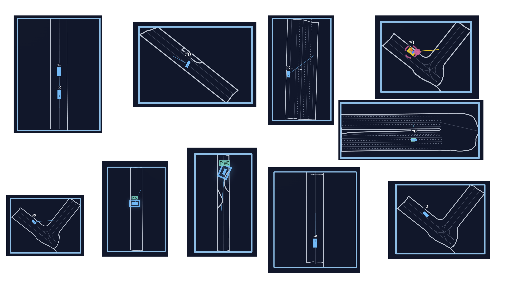

# Evaluations and benchmarks

Driving is a safety-critical multi-agent application, making careful evaluation and risk assessment essential. Mistakes in the real world are costly, so simulations are used to catch errors before deployment. To support rapid iteration, evaluations should ideally run efficiently. This is why we also paid attention to optimizing the speed of the evaluations. This page contains an overview of the available benchmarks and evals.

## Four-stage checkpoint evaluation

Run from the repository root:

```bash
python scripts/evaluate_test.py --checkpoint /path/to/model.pt
```

The script evaluates the **same checkpoint without training** in this order:

1. `sanity`: the ten curated basic maps, ten episodes per map by default.
2. `self_play`: every test scene, with eligible agents controlled by the policy.
3. `wosac`: every test scene, using the project's distributional realism metrics.
4. `human_replay`: every test scene, controlling the original dataset SDC while
   the other created agents follow logged trajectories.

Each stage creates and closes its own environments and reloads the same checkpoint.
The INI's training-time evaluation enable flags do not control this script.
Each rollout resets the environment and LSTM state. No optimizer is created and
weights are not updated. The LSTM is not warmed up with logged history, and its
state is not reset separately on an individual agent respawn.

### Inputs and defaults

| Option | Default |
| --- | --- |
| `--test-dir` | `resources/drive/binaries/testing` |
| `--num-maps` | `1000`, requiring exactly `map_000.bin` through `map_999.bin` |
| `--sanity-dir` | `resources/drive/sanity/sanity_jsons` |
| `--sanity-maps` | All ten named maps listed below |
| `--sanity-rollouts` | `10` episodes per basic map |
| `--driving-rollouts` | `1` episode per test scene in each driving stage |
| `--wosac-rollouts` | `32` simulations per test scene |
| `--batch-size` | `8` complete scenes |
| `--device` | `cuda:0` |
| `--seed` | `42` |
| `--output-dir` | `/mnt/cpfs-wlc-rdma-300t/mnt/cpfs-wlc-rdma-300t/results` |

The current resource link points to
`/mnt/cpfs-wlc-rdma-300t/mnt/cpfs-wlc-rdma-300t/pufferdrive_womd_1k/resources`.
Check the server with `readlink -f resources`. Switching the entire resource
link also changes where sanity JSONs are found. If the new directory contains
only BIN data, restore `drive/sanity/sanity_jsons`, or pass `--sanity-dir` with
the original resource location. Missing sanity resources produce a failed sanity
stage; the subsequent stages still run. The script does not substitute invented
maps for missing resources.

Sanity JSONs are converted with the existing `save_map_binary` function into a
temporary directory with unique scene IDs. The temporary sanity scenes omit
Waymo SDC/prediction indices, which may be stale after handcrafted map editing
and are not used by this stage. Original JSONs and BIN files are not modified;
the real test dataset retains its original metadata and strict index checks.
Each basic map receives a separate summary. `solved` means its mean
`score >= 0.95` after all requested rollouts; this is not the strict safe-completion
criterion. A low score is a valid evaluation result, not an execution failure.
Unlike `puffer sanity`, this stage **does not train a new model on each map**.

Select a subset of basic maps:

```bash
python scripts/evaluate_test.py --checkpoint /path/to/model.pt \
  --sanity-maps forward_goal_in_front s_curve
```

Select stages explicitly, for example to omit the basic maps:

```bash
python scripts/evaluate_test.py --checkpoint /path/to/model.pt \
  --stages self_play wosac human_replay
```

Selected stages always follow the four-stage order, regardless of argument order.
Use `--config /path/to/drive.ini` if the checkpoint uses different architecture,
action-space or reward settings. This config is merged over `config/default.ini`.

To evaluate the new two-layer MLP or the existing LSTM, select the architecture
used during training:

```bash
python scripts/evaluate_test.py --checkpoint /path/to/mlp_model.pt --model-type mlp
python scripts/evaluate_test.py --checkpoint /path/to/lstm_model.pt --model-type lstm
```

The MLP adds two `Linear(256, 256) → ReLU` layers between the existing encoder
and actor/value heads with the default configuration. These widths follow
`policy.hidden_size`. `--model-type` overrides the INI's policy/RNN selection;
it cannot be combined with `--rnn-name` in this script. All stages use the same
selection, recorded in `settings.model_type`, `policy_name`, and `rnn_name`.

To evaluate an **original feedforward Drive** checkpoint (without the new MLP
layers), override recurrence on the command
line without editing the INI:

```bash
python scripts/evaluate_test.py --checkpoint /path/to/mlp_model.pt --rnn-name None
```

`--rnn-name` accepts `None` (disable recurrence) or `Recurrent` (enable LSTM).
It takes precedence over `rnn_name` in `--config`; omitting it preserves the INI
setting. All four stages use the effective setting, which is recorded as
`settings.rnn_name` in the JSON report (`null` when disabled). The checkpoint must
match the selected architecture, and other network and action-space settings must
still match training. This flag does not convert LSTM weights into a feedforward
model; incompatible weights fail strict loading.

### Driving metrics: sanity, self-play and human replay

All native fields exported by the Drive log binding are retained per scene and
rollout. The following appear in the terminal and JSON summary:

| Metric | Meaning |
| --- | --- |
| `safe_completion_rate` | Agent fraction completing all assigned goals without any collision/offroad event over the whole scene episode. Higher is better. |
| `completion_rate` | Total completed goals / total assigned goals. Higher is better. |
| `collision_rate` | Agent fraction with any vehicle collision. Lower is better. |
| `offroad_rate` | Agent fraction with any offroad event. Lower is better. |
| `score` | Original environment success rule, which is less strict than safe completion. |
| `dnf_rate` | Agent fraction with no collision/offroad event but incomplete goals. Lower is better. |
| `episode_return` | Mean sum of the rewards emitted at each step over a controlled-agent scene episode, including steps after goal respawn. |
| `episode_length` | Mean logged episode length, in simulation steps. |
| `collisions_per_agent` | Mean number of steps classified as vehicle collision, not distinct collision events. |
| `offroad_per_agent` | Mean number of steps classified as offroad, not distinct offroad events. |
| `lane_alignment_rate` | Agent fraction aligned on the last logged step, not a time average. |
| `speed_at_goal` | Last recorded speed at a reached goal, in m/s; averaged over all agent episodes, including zero for non-finishers. |
| `goals_reached_this_episode` | Mean native completed-goal count per agent episode. Respawn repeats follow native counting rules. |
| `goals_sampled_this_episode` | Mean assigned-goal count per agent episode. |
| `perc_controlled` | Controlled fraction of created scene actors, in `[0, 1]`. |
| `perc_other` | Background fraction of created scene actors, in `[0, 1]`. |
| `agent_episodes` | Total completed controlled-agent episodes, summed from native `n`. |
| `goals_reached_total` | Total counted completed goals. |
| `goals_assigned_total` | Total assigned goals. |

Rates and means are weighted by each row's native `n` agent count. Completion is
recomputed from total goal counts; stages are never pooled together. `n` remains
in every per-scene row. Sanity additionally reports `solved_maps`,
`evaluated_maps`, `solved_rate`, and per-map metrics and solved status. Incomplete
map rollouts are not labelled solved.

These stages start at frame 0 and execute 90 transitions of a 91-frame scene.
They preserve the configured goal/reward behavior (default: respawn at the goal),
while disabling early scene termination and map resampling.

### Full WOSAC metric output

WOSAC uses `wosac_*` settings: by default frame 10 initialization,
`control_wosac`, `create_all_valid`, and stop at the goal. Each rollout collects
81 states through frame 90 using 80 actions (8 simulated seconds at `dt=0.1`).
`defer_reset=True` keeps the final frame intact. Only original `tracks_to_predict`
objects are scored, though other simulated participants affect interactions.
Within the simulator's actor capacity (default: 32), WOSAC loads the original SDC
first, then valid prediction targets, then other valid actors in object order.
This keeps targets late in the object list from being displaced by non-targets.
The script still requires every prediction target to be loaded; if the targets
and SDC themselves exceed capacity, it reports a coverage error. This capacity
also limits the background traffic represented in the realism evaluation.
This is the project's implementation with its local `wosac.ini` weights, not a
submission to an external benchmark server.

TTC is scored only for vehicle prediction targets. A scene whose prediction
targets are all pedestrians/cyclists has no defined TTC score. The four-stage
script retains this scene and continues to later batches. Its TTC,
`interactive_metrics`, and `realism_meta_score` are JSON `null` with explanations
in the per-scene `not_applicable` field. All other computable metrics are retained.
No zero/one score is substituted and the composite weights are not renormalized.

Each metric is averaged only over scenes where it is applicable. In particular,
the composite uses only scenes with all required metrics, while ADE and other
available metrics include nonvehicle-only scenes. `metric_coverage.wosac` records
the valid-scene count for each metric, also printed as `(valid/processed scenes)`.
For example, `realism_meta_score ... (980/1000 scenes)` is a score for 980 scenes,
even though all 1000 were evaluated. If no scene supports a metric, its summary
is `null` (`N/A` in the terminal), including the composite standard deviation.
An otherwise successful run is `complete` once all scenes have been processed.
Report schema version 5 introduces these applicability and coverage fields.

This exception applies only to absent vehicle prediction targets. Invalid
trajectories, missing targets, and undefined metrics for other reasons still
produce an error. The shared evaluator retains strict behavior unless its caller
explicitly enables `allow_undefined_ttc` and handles the missing scores.

| Metric | Meaning |
| --- | --- |
| `realism_meta_score` | Weighted composite of the feature likelihood scores. Higher is better. |
| `ade` | Mean displacement error over valid reference frames and rollouts, in metres. Lower is better. |
| `min_ade` | Best rollout ADE per scored object, then averaged. Lower is better. |
| `kinematic_metrics` | Mean of the four motion likelihood scores. |
| `interactive_metrics` | Mean of nearest-object, TTC and collision likelihood scores. |
| `map_based_metrics` | Mean of road-edge distance and offroad likelihood scores. |
| `likelihood_linear_speed` | Linear-speed realism score. |
| `likelihood_linear_acceleration` | Linear-acceleration realism score. |
| `likelihood_angular_speed` | Angular-speed realism score. |
| `likelihood_angular_acceleration` | Angular-acceleration realism score. |
| `likelihood_distance_to_nearest_object` | Nearest-object distance realism score. |
| `likelihood_time_to_collision` | Time-to-collision realism score. |
| `likelihood_collision_indication` | Any-collision event realism score. |
| `likelihood_distance_to_road_edge` | Road-edge distance realism score. |
| `likelihood_offroad_indication` | Any-offroad event realism score. |
| `num_collisions_sim` / `num_collisions_ref` | Simulated/reference any-collision fractions; despite their names, these are not event counts. |
| `num_offroad_sim` / `num_offroad_ref` | Simulated/reference any-offroad fractions. |
| `num_agents_per_scene` | Mean number of scored objects per scene; per-scene rows retain the individual counts. |
| `realism_meta_score_std` | Population standard deviation over applicable scene scores; zero for one scene and null for none. |
| `total_num_agents` | Scored objects summed across scenes, not multiplied by rollout count. |
| `total_unique_scenarios` | Number of processed scenes, including those where TTC and composite scores are not applicable. |

`likelihood_*` are exponentiated log-likelihood scores, higher is better.
ADE/minADE are not part of the composite. The current implementation does not
calculate a traffic-light violation score. WOSAC summaries weight scenes equally
and retain full precision. Every requested scene and prediction target must be
represented; missing targets, including those excluded by simulator capacity,
produce a failed stage instead of silently changing the scoring population.
Before metric computation, all simulated participants must have finite positions
and headings, and finite positive dimensions. Reference positions and headings
must be finite on valid frames, including those of interaction partners.
Non-finite trajectories fail the stage rather than being silently omitted from
histograms or scene averages.

### SDC and prediction metadata

Self-play allows an unset SDC (`-1`); a nonnegative SDC must be a valid vehicle
index. Human replay requires the original SDC to be valid at frame 0. WOSAC requires
valid, nonempty prediction indices and valid initial/future reference trajectories.
SDC and prediction indices must refer to the current object list. An object ID
is not necessarily its list index, and passing bounds checks cannot establish
that an upstream mapping is semantically correct.

The converter preserves the SDC and prediction indices from the source JSON:

```bash
python pufferlib/ocean/drive/drive.py --data-folder /path/to/testing_jsons \
  --output-dir resources/drive/binaries/testing --workers 8
```

Human replay always controls the vehicle identified by the original
`sdc_track_index`; all other vehicles replay their logged trajectories. Its
object-list index and object ID are recorded in `ego_selection`. Missing or
invalid SDC metadata fails this stage. The evaluator never selects a replacement
vehicle or rewrites the test maps.

### Reports and failure handling

The terminal prints all metrics, stage status and coverage, plus individual
sanity-map results. One `test_metrics_<UTC timestamp>_<id>.json` is saved under
`--output-dir` and atomically updated after each stage. Report `schema_version: 4`
contains `stage_order`, `stages`, `settings`, `metric_notes`, `metrics`, `per_scene`,
`sanity_results`, coverage, ego selections and WOSAC target IDs where applicable.
Each stage has its own requested scene count (ten basic maps versus 1000 test
scenes by default).

A failed stage records its error and partial results; later stages still run.
If partial results cannot be aggregated, their per-scene rows remain in the report,
the stage records `aggregation_error`, and its summary metrics are reset to `null`.
An earlier batch's summary is never presented as the final summary for those rows.
Unavailable metrics are `null`, not invented zeroes. An explicitly omitted stage
is `skipped` with a reason. Overall `status: complete` and exit code 0 require all
selected stages to complete. Low driving scores or unsolved basic tasks do not
make execution fail. No WandB account or rendering is required.

## Safe goal completion

`safe_completion_rate` is the fraction of evaluated agent episodes that completed
all assigned goals without any vehicle collision or off-road event during the
entire scene episode. It is an agent-weighted rate in `[0, 1]`, not a per-step rate
or a product of the separate collision, off-road, and completion rates.

An individual agent respawn does not erase earlier violations; violations after
reaching a goal also disqualify the episode. For generated goals, every assigned
goal must be completed, including the final goal (unlike `score`, which permits
one unfinished goal when multiple goals were assigned).

The metric is available in environment `info` logs and in
`Evaluator.self_play_stats` / `Evaluator.human_replay_stats`. Training logs it as
`environment/safe_completion_rate`; evaluation logs it to WandB as
`eval/sp_safe_completion_rate` or `eval/hr_safe_completion_rate`.
When combining batches, weight each batch's rate by its logged `n` agent count.

Rebuild the C extension after updating: `python setup.py build_ext --inplace --force`.

## Sanity maps 🐛

This original command starts a separate training run on each selected map.
It inherits the configured training budget; set `--train.total-timesteps` for a
short run. It differs from the inference-only sanity stage in `evaluate_test.py`.
Disable training-time evaluations if you want no dependency on the full dataset.
Each sanity map tests a specific behavior.

```bash
puffer sanity puffer_drive --wandb --sanity-maps forward_goal_in_front s_curve
```

Or run them all at once:

```bash
puffer sanity puffer_drive --wandb
```

- Tip: turn learning-rate annealing off for these short runs (`--train.anneal-lr False`) to keep the sanity checks from decaying the optimizer mid-run.

Available maps:

- `forward_goal_in_front`: Straight approach to a goal in view.
- `reverse_goal_behind`: Backward start with a behind-the-ego goal.
- `two_agent_forward_goal_in_front`: Two agents advancing to forward goals.
- `two_agent_reverse_goal_behind`: Two agents reversing to rear goals.
- `simple_turn`: Single, gentle turn to a nearby goal.
- `s_curve`: S-shaped path with alternating curvature.
- `u_turn`: U-shaped turn to a goal behind the start.
- `one_or_two_point_turn`: Tight turn requiring a small reversal.
- `three_or_four_point_turn`: Even tighter turn needing multiple reversals.
- `goal_out_of_sight`: Goal starts without direct path; needs some planning.



## Distributional realism benchmark 📊

We provide a PufferDrive implementation of the Waymo Open Sim Agents Challenge (WOSAC) for fast, easy evaluation of how well your trained agent matches distributional properties of human behavior.

```bash
puffer eval puffer_drive --eval.wosac-realism-eval True
```

Add `--load-model-path <path_to_checkpoint>.pt` to score a trained policy, instead of a random baseline.

See [the WOSAC benchmark page](wosac.md) for the metric pipeline and all the details.

## Human-compatibility benchmark 🤝

You may be interested in how compatible your agent is with human partners. For this purpose, we support an eval where your policy only controls the self-driving car (SDC). The rest of the agents in the scene are stepped using the logs. While it is not a perfect eval since the human partners here are static, it will still give you a sense of how closely aligned your agent's behavior is to how people drive. You can run it like this:

```bash
python scripts/evaluate_test.py --stages human_replay --checkpoint <path_to_checkpoint>.pt
```

During this evaluation the self-driving car (SDC) is controlled by your policy while other agents replay log trajectories.
